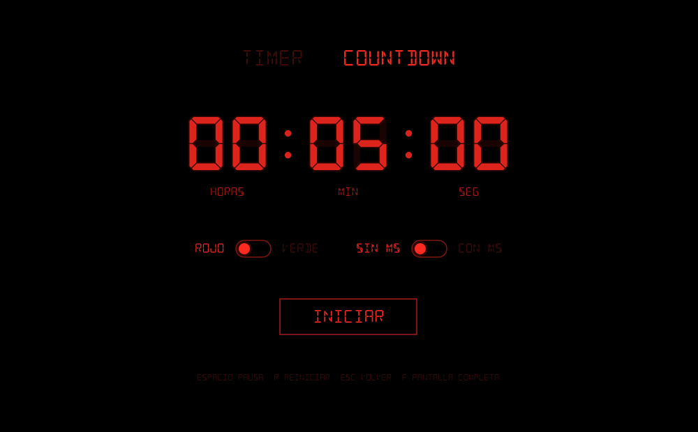
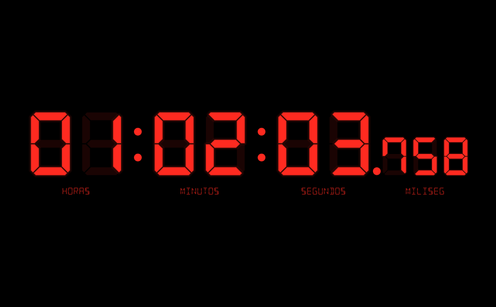
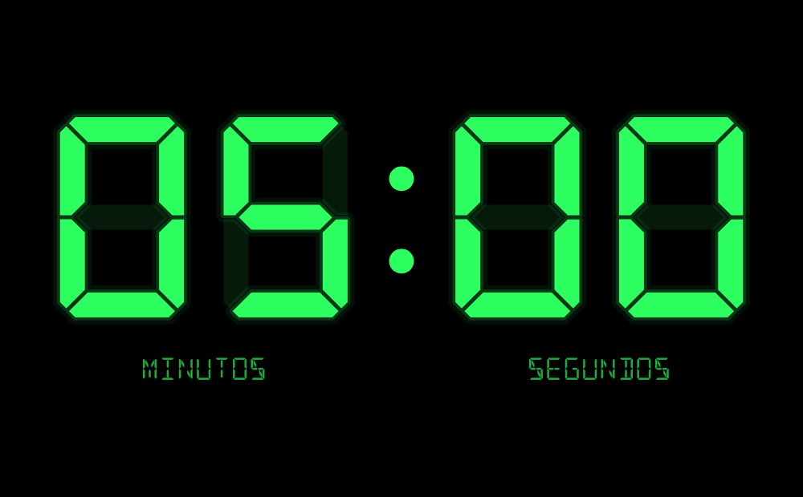

# Reloj

**[Español](#español) · [English](#english)**







---

## Español

Timer y countdown con estética de display de segmentos: fondo negro, tipografía digital y nada más que lo esencial. Disponible como app de escritorio (Java) y como página web.

**▶ Pruébalo en el navegador:** https://JoeLeegt.github.io/Digital-Countdown/

### Versión web

La versión web vive en `docs/index.html`: un solo archivo, sin dependencias externas, con las fuentes incluidas. Funciona en computadoras, tablets y celulares, y se publica con GitHub Pages.

Al terminar una cuenta regresiva suena una alarma bip-bip de 880 Hz, generada con la Web Audio API, que se repite cada segundo hasta que la detengas: cualquier tecla, clic o toque la apaga y el reloj queda fijo en 00:00. La alarma se programa sobre el reloj de audio al iniciar o reanudar, así que suena puntual aunque la pestaña quede en segundo plano. Los navegadores solo permiten audio después de una interacción, por eso se activa al presionar INICIAR. En iPhone, el interruptor de silencio también silencia la página.

En pantallas táctiles: toca para pausar o reanudar, doble toque para pantalla completa y mantén presionado para volver. Mientras el reloj corre, la página pide al navegador mantener la pantalla encendida (si lo soporta).

### Descargar la app de escritorio

Ve a la sección [**Releases**](../../releases) y descarga la versión más reciente:

- **`Reloj-Windows.zip`**: no requiere Java. Extrae el zip, abre la carpeta `Reloj` y ejecuta `Reloj.exe`. Mantén `Reloj.exe` junto a las carpetas `app` y `runtime`.
- **`Reloj.jar`**: para Windows, macOS o Linux con Java 11 o superior instalado. Se abre con doble clic o con `java -jar Reloj.jar`.

La primera vez, Windows SmartScreen puede advertir que el programa no está firmado. Haz clic en *Más información → Ejecutar de todas formas*.

### Cómo se usa

En la pantalla de configuración:

- Elige **TIMER** (cuenta hacia arriba) o **COUNTDOWN** (cuenta hacia abajo).
- Define el tiempo en HH : MM : SS. Haz clic en un campo y escribe los dígitos, o usa las flechas ↑ ↓ o la rueda del mouse.
- En modo TIMER, el tiempo funciona como límite. Si lo dejas en `00:00:00`, el timer corre sin límite.
- El switch **ROJO / VERDE** cambia el color de toda la interfaz.
- El switch **SIN MS / CON MS** muestra u oculta los milisegundos.
- Presiona **INICIAR** o Enter.

La vista del reloj solo muestra los dígitos y sus etiquetas. Las horas aparecen cuando el tiempo es de una hora o más. Al terminar, los dígitos parpadean y suena un aviso.

| Tecla | Acción |
|---|---|
| Espacio | Pausar / reanudar |
| R | Reiniciar |
| Esc | Volver a la configuración |
| F, F11 o doble clic | Pantalla completa |
| C | Cambiar entre rojo y verde |

La app recuerda el color y la opción de milisegundos entre sesiones.

### Compilar desde el código

Requiere un JDK 11 o superior.

```bash
mkdir build
javac --release 11 -encoding UTF-8 -d build src/Reloj.java
cp -r res/fonts build/
jar cfm Reloj.jar manifest.txt -C build .
java -jar Reloj.jar
```

En Windows (PowerShell), reemplaza `cp -r res/fonts build/` por `Copy-Item -Recurse res\fonts build\`.

#### Ejecutable para Windows

La forma más sencilla es usar `jpackage` (incluido en el JDK 14+) desde Windows:

```bash
jpackage --input . --main-jar Reloj.jar --name Reloj --type app-image --icon windows-launcher/icon.ico
```

La carpeta `windows-launcher/` contiene el lanzador en C usado para la versión publicada en Releases. Busca un runtime mínimo en `runtime/` (creado con `jlink --add-modules java.desktop,java.prefs`) y el programa en `app/Reloj.jar`. Se compila con MinGW:

```bash
x86_64-w64-mingw32-windres windows-launcher/res.rc -O coff -o res.o
x86_64-w64-mingw32-gcc -DUNICODE -D_UNICODE -municode -mwindows -O2 -s windows-launcher/main.c res.o -o Reloj.exe
```

### Créditos

Tipografía [DSEG](https://github.com/keshikan/DSEG) de keshikan, distribuida bajo la SIL Open Font License 1.1 (ver `res/fonts/DSEG-LICENSE.txt`).

### Licencia

El código de este proyecto se distribuye bajo la licencia MIT. Consulta el archivo [LICENSE](LICENSE). La tipografía conserva su propia licencia.

[↑ Volver arriba](#reloj)

---

## English

A timer and countdown with a segment-display look: black background, digital typeface, and nothing beyond the essentials. Available as a desktop app (Java) and as a web page.

**▶ Try it in your browser:** https://JoeLeegt.github.io/Digital-Countdown/

### Web version

The web version lives in `docs/index.html`: a single file with no external dependencies and the fonts embedded. It works on computers, tablets, and phones, and is published with GitHub Pages.

When a countdown ends, an 880 Hz beep-beep alarm generated with the Web Audio API repeats every second until you stop it: any key, click, or tap silences it and the clock stays at 00:00. The alarm is scheduled on the audio clock when you start or resume, so it plays on time even if the tab is in the background. Browsers only allow audio after a user interaction, so it is enabled when you press INICIAR (Start). On iPhone, the silent switch also mutes the page.

On touch screens: tap to pause or resume, double-tap for full screen, and press and hold to go back. While the clock is running, the page asks the browser to keep the screen on (where supported).

### Download the desktop app

Go to the [**Releases**](../../releases) section and download the latest version:

- **`Reloj-Windows.zip`**: no Java required. Extract the zip, open the `Reloj` folder, and run `Reloj.exe`. Keep `Reloj.exe` next to the `app` and `runtime` folders.
- **`Reloj.jar`**: for Windows, macOS, or Linux with Java 11 or later installed. Open it with a double-click or with `java -jar Reloj.jar`.

The first time, Windows SmartScreen may warn that the program is unsigned. Click *More info → Run anyway*.

### How to use it

The interface is in Spanish. On the setup screen:

- Choose **TIMER** (counts up) or **COUNTDOWN** (counts down).
- Set the time as HH : MM : SS (**HORAS** = hours, **MIN** = minutes, **SEG** = seconds). Click a field and type the digits, or use the ↑ ↓ arrow keys or the mouse wheel.
- In TIMER mode, the time acts as a limit. If you leave it at `00:00:00`, the timer runs with no limit.
- The **ROJO / VERDE** (red / green) switch changes the color of the whole interface.
- The **SIN MS / CON MS** (without / with ms) switch hides or shows milliseconds.
- Press **INICIAR** (Start) or Enter.

The clock view shows only the digits and their labels. Hours appear when the time is one hour or more. When time is up, the digits blink and an alert sounds.

| Key | Action |
|---|---|
| Space | Pause / resume |
| R | Restart |
| Esc | Back to setup |
| F, F11, or double-click | Full screen |
| C | Switch between red and green |

The app remembers your color and millisecond settings between sessions.

### Building from source

Requires JDK 11 or later.

```bash
mkdir build
javac --release 11 -encoding UTF-8 -d build src/Reloj.java
cp -r res/fonts build/
jar cfm Reloj.jar manifest.txt -C build .
java -jar Reloj.jar
```

On Windows (PowerShell), replace `cp -r res/fonts build/` with `Copy-Item -Recurse res\fonts build\`.

#### Windows executable

The simplest option is `jpackage` (included in JDK 14+), run on Windows:

```bash
jpackage --input . --main-jar Reloj.jar --name Reloj --type app-image --icon windows-launcher/icon.ico
```

The `windows-launcher/` folder contains the C launcher used for the version published in Releases. It looks for a minimal runtime in `runtime/` (created with `jlink --add-modules java.desktop,java.prefs`) and for the program in `app/Reloj.jar`. Build it with MinGW:

```bash
x86_64-w64-mingw32-windres windows-launcher/res.rc -O coff -o res.o
x86_64-w64-mingw32-gcc -DUNICODE -D_UNICODE -municode -mwindows -O2 -s windows-launcher/main.c res.o -o Reloj.exe
```

### Credits

[DSEG](https://github.com/keshikan/DSEG) typeface by keshikan, distributed under the SIL Open Font License 1.1 (see `res/fonts/DSEG-LICENSE.txt`).

### License

This project's code is released under the MIT License. See the [LICENSE](LICENSE) file. The typeface keeps its own license.

[↑ Back to top](#reloj)
